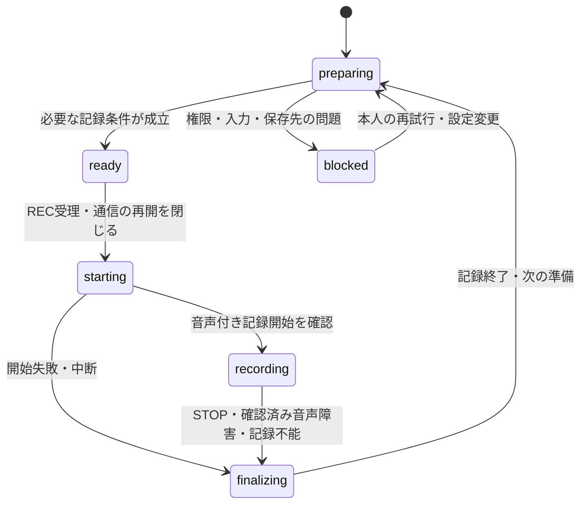

# 機能設計書

## 対象範囲と要件対応

- 対象: FrameRelay初期版の全P0要求（FR-01〜17、NFR-01〜04）。要求の正本は、補足R2を含め2026-09-25に全体承認され、2026-09-26の明示回答を補足R3として反映した[プロダクト要求定義書](product-requirements.md)（以下PRD）。R3は全体承認を維持する。初期要件へ要求の更新先を戻さない。
- 文書状態: 機能設計案。要求の合意、本文の設計判断、ユーザー判断待ち、実機検証待ち、既存実装確認待ちを区別する。設計・API・機種名が記載されていても、実装済み・対応確認済みを意味しない。
- 技術前提: [PROJECT_CONTEXT.md](../PROJECT_CONTEXT.md)のSwift・SwiftUI・native iOS・既存Xcode projectを維持する。状態管理方式、通信プロトコル、永続化方式、ハッシュ方式、描画・撮影API、ディレクトリ配置はアーキテクチャ設計で決める。
- 本書で具体化するもの: 画面の責務、利用者イベント、状態と不変条件、サービス境界、復旧・競合、受入試験への対応。U1〜U3のR3確定部分と残件、U4〜U8の確定部分と残件を区別し、残る操作案は実装前に判断する。ユーザー判断待ちを理由にP0を任意機能へ落とさない。
- 対象外・禁止動作はPRDを継承する。特に原本自動削除、無音録画継続、全体自動再起動、勝手な形式・露出・補正変更、クリップ間WB固定の持越しを導入しない。タイムライン編集・汎用取り込み・旧「写真」原本削除・LUT選択UI・Rec.709高品質版の常時生成も追加しない。
- S41の通常撮影に関する追記は、設定・保存・一覧接続の契約を扱う。実装進捗と検証証跡は[現行tasklist](../.steering/20260929-device-independent-implementation/tasklist.md)を正本とし、動線全体や実機受入の完了を意味しない。

設計箇所の記号は、F=利用者フロー、V=画面、D=データ契約、S=状態遷移、I=外部境界、T=テスト、U=確定部分とユーザー判断待ちの整理を表す。受入条件の範囲は同じ要求の連続する枝番を含み、下表は21要求・79受入条件を対象とする。T項目は試験計画であり未実施。

| PRD要件（全てP0） | 受入条件 | 設計箇所 | テスト観点 |
| --- | --- | --- | --- |
| FR-01 撮影形式・手動設定・保存 | AC-FR-01-01〜04 | F1、V1・V2、D1、S1・S2、I1 | T01 形式・手動設定・原本の所在 |
| FR-02 撮影プレビュー | AC-FR-02-01〜02 | V1、S2、I1 | T02 表示と記録経路の分離 |
| FR-03 手ブレ補正 | AC-FR-03-01〜05 | V2、D1、S2、U6 | T03 OFF＋複数モード・復元・画角・両立 |
| FR-04 WB | AC-FR-04-01〜03 | F1、V1、S1・S2 | T04 REC境界・明示合わせ直し・次クリップ |
| FR-05 人物・AF | AC-FR-05-01〜05 | V1、D2、S2、U5 | T05 通常追従・追跡OFF・見失い・不確実性 |
| FR-06 ND | AC-FR-06-01〜04 | V1、D2、S2、I2 | T06 有用な方向・根拠・古い結果の保留 |
| FR-07 ズーム | AC-FR-07-01〜03 | V1、D2、S2、U4 | T07 予告・移動・停止・実画角・画質 |
| FR-08 レンズ切替 | AC-FR-08-01〜03 | V1・V2、D1、S2、U6 | T08 限定ISO補正・実適用・連続性 |
| FR-09 音声 | AC-FR-09-01〜04 | F1、V1、S1、I1、E1 | T09 静寂・入力障害・書込・復旧 |
| FR-10 ライブラリ | AC-FR-10-01〜03 | F2〜F5、V3〜V6、D3・D8、S3、U1・U2 | T10 操作別の粒度・動画別結果・再生元 |
| FR-11 原本転送・検証 | AC-FR-11-01〜04 | F2、V3・V6、D4・D8、S4、I3 | T11 複数開始・対象固定・Wi-Fi・保存検証の独立 |
| FR-12 軽量版生成 | AC-FR-12-01〜03 | F2、D4、S4、I3・I4 | T12 変換・保持項目・旧MediaVaultとの差 |
| FR-13 確認・差し替え | AC-FR-13-01〜06 | F3、V4、D4・D5・D7、S5、I3・I6、U2 | T13 1本ずつのストリーミング確認・V1/V2・失効順序 |
| FR-14 容量整理 | AC-FR-14-01〜07 | F3、V5、D5・D6・D8、S5・S6 | T14 複数対象の個別判定・オフライン・競合・削除復旧 |
| FR-15 「写真」保存 | AC-FR-15-01〜05 | F4、V3・V4・V6、D7・D8、S7、I5、U2 | T15 複数開始・動画別登録結果・重複・一時コピー |
| FR-16 通信・録画優先 | AC-FR-16-01〜03 | F1〜F4、V6、D8、S1・S4、I6、U3 | T16 全動画通信・REC・保存・条件付き自動再開 |
| FR-17 不要動画の破棄 | AC-FR-17-01〜06 | F5、V5、D6、S6 | T17 対象とリスク・状態非偽装・ローカル削除 |
| NFR-01 応答性 | AC-NFR-01-01 | F1、S1・S4、I1 | T18 起動・次REC・通信停止の影響 |
| NFR-02 状態信頼性 | AC-NFR-02-01〜04 | D3〜D8、S3〜S7、E1〜E5 | T19 各処理境界の中断・再起動 |
| NFR-03 品質・継続性 | AC-NFR-03-01〜02 | S1・S2、I1・I2、検証待ち表 | T20 合意条件と実ファイルによる評価 |
| NFR-04 開発データ | AC-NFR-04-01〜02 | I7、テスト戦略 | T21 旧原本と新規撮影の試験経路・整理権限 |

## 利用者フロー

R3で確定した操作ごとの対象粒度は次のとおり。複数選択では本人がまとめて開始した対象集合を固定し、D8に従って動画ごとの操作・条件・結果を追跡する。内部は順次処理でよく、複数同時通信を要件にしない。

| 操作 | 初期版の粒度 | 維持する条件 |
| --- | --- | --- |
| 原本転送 | 複数選択してまとめて開始 | Wi-Fiでの開始受理、動画別の送信と保存・全内容検証の区別 |
| 軽量版の「写真」保存 | 複数選択してまとめて開始 | 動画別の取得・登録結果、重複防止と一時コピー解放 |
| 条件を満たす原本の容量整理 | 複数選択してまとめて実行 | 各実行直前の保存・検証・明示確認・対応・失効・排他の照合 |
| 軽量プレビュー再生・明示確認 | 1本ずつ | 実際に再生した同じ版への本人の明示確認。複数選択を確認に代用しない |
| 不要動画の破棄 | 1本ずつ | 本人が各対象・消失リスクを確認して明示指示。一括破棄なし |

選択しただけでは開始指示にならない。開始受理後の順番待ちは指示済みとし、後から撮影・表示・選択された動画を自動追加しない。処理順、一部失敗後の続行/停止、一括停止UI等はU1・U3の残件とする。

### F1 起動から録画・次の撮影へ

通常撮影は試験票を要求せず、撮影設定→REC/STOP→アプリ内保存→一覧から既存の原本再生へつなぐ。探索用の試験参照や試験時間上限を通常撮影の開始条件にしない。保存結果の確定後は原本との内容対応を照合して一覧を更新し、保存分類・内容対応・再生可否を別々に示す。撮影を準備できない端末や権限拒否時も、ライブラリへの入口を維持する。

1. 保存済み撮影設定を読み、現在の端末・カメラ・形式の対応情報と照合する。カメラ・マイク・内部保存先を準備し、入力有効性を確認する。初回権限取得、通常起動、復帰を区別する。
2. 撮影画面に実適用値と準備状態を出す。WBはAuto。補正は初回の標準相当候補または前回選択を対応確認後に適用する。非対応・未確認の場合は制約と選択肢を示し、代替を勝手に適用しない。
3. 人物・ND解析の完了を待たず、必要な記録条件が整えばRECを受け付ける。REC受付で動画通信の再開を閉じ、端末上の送受信を一時停止する。サーバー応答や未完了のサムネイル生成を待つことを開始条件にしない。
4. REC時点で得られているWBを記録用に固定し、音声付き記録の開始を確認して録画中表示へ移る。WBの安定待ちは入れない。REC受付・記録開始・最初のフレームは別の時点として測定する。
5. 録画中は音声メーター・入力有効性と実適用値を継続表示する。ズーム・対応するレンズ切替・WBの明示合わせ直しを扱う。STOPまたは確認済み音声障害・記録不能で記録停止へ進む。
6. 最後の記録フレームまでWB固定を保ち、記録終了後に待機用Autoへ戻す。ファイルの確定・照合を行い、正常保存・部分保存・結果不明・失敗を通知する。録画停止を保存成功とは扱わない。
7. 推奨操作案U1では撮影画面に留まり、保存結果を控えめに通知する。次のRECは記録先・音声等が準備でき次第許可する。前クリップのサムネイル・管理情報の後処理は分離し、未完了保存は保持する。記録と確定書込の並行可能性は実機検証対象で、必要な準備中は理由を表示する。

### F2 手動転送からRec.709軽量版生成へ

1. ライブラリの原本が存在する項目を複数選択して「Mac miniへ転送」をまとめて指示できる。新規の指示はWi-Fi接続時のみ受理し、不在時は接続案内を出して、復帰時に開始する予約を作らない。動画別に対象を照合し、正常保存は通常の対象、部分保存は再生可能性と対象ファイルの確定後にその状態を示して扱う。保存中・結果不明・失敗中のファイルはそのまま送らず、先にローカル照合する。
2. 受理した対象集合と動画別の操作IDを保持し、各実行時に認証・接続先、録画・保存との競合、本人の停止/キャンセル状態とWi-Fiの継続を確認する。順番待ちも開始指示済みとし、受理後のWi-Fi切断等で実行できなければ具体的な待機理由を出す。本人が止めていない未完了通信はS4の条件再確認後に自動再開する。
3. 原本の同一性と転送操作IDを付けて送信する。送信完了後もMac miniの保存・整合性検証結果が確定するまで「保存検証待ち」とする。再送・再照会は同一操作を識別し、別原本を作る操作と分ける。
4. Mac mini側で原本の保存・検証が成功した場合だけ、自動でRec.709軽量版生成へ進む。未変換の圧縮版を完成品へ昇格させない。原本は改変せず、生成失敗は保存検証の成功と分けて表示する。
5. 生成済み版の原本ID・映像ID・変換情報を受け取る。初回生成と、確認済みV1に対する新版V2の生成・差し替えを分け、後者はS5へ進む。iPhoneのRECでMac miniの開始済み変換は止めない。
6. 動画別に送信、保存検証、変換の成否・結果不明・待機・未処理を表示する。一部の成功を全対象の成功にせず、再開で対象集合を増やさない。

### F3 軽量プレビュー確認と容量整理

1. 項目の「Rec.709軽量版を確認」から、1本ずつ対象原本・変換版・映像IDを固定して再生する。「写真」保存用と同じMac mini生成軽量版を全体の一時取得を待たずに確認できるストリーミングを第一候補とする。Wi-Fi・録画/保存優先・一時使用量管理に従い、成立性はI3/I6で検証する。取得済みのローカル動画はオフラインでも再生できる。
2. 実際の映像が再生された同じ版に対して、1本ずつ「この軽量版の内容を確認した」を押す。全体の軽量版ダウンロード、全編再生や一定秒数の視聴を条件にしない。再生開始失敗、単なるサムネイル表示、撮影プレビュー、未変換版、複数選択は確認にならない。ストリーミングの再生到達を原本全内容の保存・整合性検証や「写真」保存の代用にしない。
3. 原本・映像ID・確認世代の対応を再照合し、確認記録を永続保存する。記録保存の確定後だけ「明示確認済み」とする。別版へ変わっていた場合は古い操作を反映しない。
4. 保存検証・Rec.709版・有効な確認・ローカル原本の対応から動画別に容量整理可能性を判定し、条件を満たす原本を複数選択して「iPhone原本を容量整理」をまとめて指示できる。削除前の対象表示では動画別の撮影日時・サムネイル・サイズと最後に取得したMac mini保存検証の記録を示す。
5. 本人が指示した対象集合を固定し、各削除の実行直前に端末内の最新の保存・検証・明示確認・対応・失効状態と排他を再照合する。選択後に失効した対象は削除せず、破棄へ自動移行しない。Mac mini再接続・再生・「写真」保存・追加バックアップ・高品質版生成を追加条件にしない。
6. S6の手順でローカル原本だけを削除・照合し、動画別に削除済み・未削除・確認が必要・未処理を表示する。結果と撮影行を残す。オフライン時は「保存検証の最終記録に基づく操作」であり、Mac mini原本の現在の存在を照合した表示にしない。

### F4 同じ軽量版を「写真」へ保存

1. ユーザーが複数の動画を選択し、対象軽量版の「写真に保存」をまとめて指示できる。新規の指示はWi-Fi接続時のみ受理し、不在時は接続案内を出して開始予約を作らない。容量整理の前後どちらからも開始できる。必要な追加権限がないときは権限取得または設定変更を案内する。権限の取得方針はU2の未合意案と分ける。
2. 受理した対象集合と動画別の操作ID・撮影/変換版/映像の対応を固定し、各動画の登録状態を確認する。登録済み、登録中、結果不明を無条件に新規追加しない。U2の照合案に従って確認が必要な状態を解決する。
3. Wi-Fiで対象版を一時取得する。内部は順次処理でよく、受理後の順番待ちや切断による待機も開始指示済みとしてS4の条件付き自動再開を適用する。取得完了と登録成功を分け、登録操作の意図を永続保存してから「写真」へ追加する。正当に開始した操作で取得済みの版をローカルに登録する段階には、Wi-Fiの継続を要求しない。撮影日時を維持し、取得日時で置き換えない。
4. 動画別に登録結果・アセット対応を保存したら成功を表示し、使用中でない一時コピーを解放する。取得・登録の失敗/結果不明/未処理も動画別に示す。通信の自動再開を結果不明の登録の自動再実行へ拡張せず、利用者が後から「写真」で削除しても自動復活させない。

### F5 不要なiPhone原本を破棄

1. ユーザーが1本ずつ項目の別操作「不要な原本を破棄」を開く。複数選択による一括破棄は行わない。容量整理が不可でもこの操作へ自動的に誘導・切替しない。
2. 対象の撮影日時・サムネイル・サイズ、iPhone原本だけが対象であること、転送・保存検証の状態を示す。未転送・検証不明等では「Mac miniへの保存が確認できないため、この原本を失う可能性があります」と明示する。部分保存の場合はその状態も示す。
3. 対象と消失リスクを本人が確認して「このiPhone原本を破棄」を明示する。軽量プレビューの確認ボタンとは別のイベントとし、FR-13の確認記録を作らない。
4. 録画・保存・転送等との競合をS6に従って解消する。競合の解消中に対象や状態が変わったら古い確認で自動実行せず、新しい表示で操作を受け直す。
5. ローカル原本の削除結果を照合して「破棄済み」「未削除」「確認が必要」を区別する。Mac mini・「写真」を連動削除せず、保存検証や軽量版確認の状態も変更しない。

## 画面・View

Viewは表示とイベント発行を担う。記録開始・原本削除・確認確定・「写真」追加をView自身で行わない。下表の「所有者」は論理上の責務であり、ViewModel等の実装パターンを指定しない。操作の可否と不可理由は共通の規則で計算し、画面ごとに判定を複製しない。

| ID・画面 | 責務、入力・出力 | 状態の所有者・更新経路・依存先 | 禁止事項・空／待機状態 |
| --- | --- | --- | --- |
| V1 撮影 | 撮影プレビュー、実カメラ・倍率・ISO・シャッター・対応時の絞り、補正、WB、音量と入力有効性、ND、人物、RECを表示。設定変更・人物指定・ズーム・REC/STOP等を出力 | 撮影調整担当がセッションを所有。Viewイベント→規則検証→撮影I/O→実適用結果。人物/ND解析結果は現在世代だけ反映。ライブラリへの保存結果はクリップIDで共有 | 未準備に偽のライブ映像を出さない。入力確認中・権限拒否・REC開始待ち・停止/保存中・障害を区別。赤い×は確認済み音声入力障害に使い、音割れは別表示 |
| V2 撮影設定 | 標準/上位/容量優先、24/30fps、カメラ、手動値、補正の対応・理由と実適用値を示す | 設定担当が希望値を永続所有し、撮影担当が現在適用値を所有。設定イベントを組合せ単位で検証し、成功した適用を表示。対応情報I1に依存 | 希望値を実適用値として表示しない。未確認と非対応を区別。録画中の形式・fps・補正切替は無効化する案U6。絞り非対応なら操作部を出さない |
| V3 ライブラリ・項目詳細 | 一撮影の原本所在、保存結果、転送、Mac mini検証、変換、明示確認、「写真」、容量整理/破棄を別ラベルで示す。転送/写真保存/条件を満たす容量整理の複数選択・開始と、1本ずつの再生/明示確認/破棄を出力 | ライブラリ担当が撮影IDによる統合表示を所有。選択状態とD8の開始受理済み対象集合を分離し、D3〜D8の動画別の成否・待機・未処理・要確認を示す。I/O結果は各担当経由で更新 | 初回は「撮影した動画はありません」。読込中・取得失敗・古いサーバー記録を区別。一部成功を全件成功にせず、複数選択を明示確認にしない。削除候補は自動削除予約ではない。破棄を「安全に容量整理済み」と表示しない |
| V4 原本／軽量版再生 | 再生元を明示し、原本の単純再生と1本ずつのRec.709軽量版の確認を分ける。ストリーミングを第一候補とし、軽量版のみ「この内容を確認した」、別操作の写真保存を表示 | 再生担当は固定した原本/変換版/映像の再生トークン・実再生到達を所有。確認担当は永続確認記録を所有。再生イベント→版の再照合→確認保存。I3・I5・I6に依存 | 原本再生に軽量版の確認を流用しない。Wi-Fi待ち・バッファ待ち・再生不能・一時容量不足・原本なし・版変更を明示。全体取得なしの途中再生で確認可。再生成功を原本検証/写真保存にせず、画面離脱で未指示の確認を確定しない |
| V5 容量整理／破棄の確認 | 二つの操作を別のタイトル・理由・決定ボタンで表示。容量整理は複数の対象と動画別条件/結果、破棄は1本の対象と消失リスクを示す | ローカル原本管理担当が固定した対象集合と動画別スナップショット・操作IDを所有。本人の確定イベント→各実行直前の最新条件照合→S6。失効と同じ項目の排他境界を使う | 共通の曖昧な「削除」だけにしない。容量整理不可時に破棄へフォールバックせず、一括破棄なし。処理中の連打を受け付けず、結果不明/未処理を成功にしない |
| V6 接続・処理状況 | 接続先、接続/認証/権限の状態、動画別の待機理由・成否・未処理・要確認、既開始通信の条件付き自動再開/本人停止を表示 | 接続担当と操作担当が事実を所有。D8の対象集合・個別操作を参照し、順番待ちと未指示を区別。画面は認証情報等を直接管理せずサービスへイベントを渡す。具体的な設定項目や停止UIは既存実装確認・U3の合意後に定義 | URL・認証方式の存在を仮定しない。動画通信が止まった理由を「失敗」に一括せず、選択だけの項目を自動開始しない。背景/画面ロック後の継続を保証しない |

操作名・状態は色だけで区別しない。REC、音声障害、確認失効、容量整理と破棄の各ボタンには読み上げ可能な名前と状態を用意する。動く人物枠や解析の頻繁な更新を、そのまま連続した読み上げ通知にしない。具体的な配置・サイズ・縦横レイアウトは実機の操作評価で詰める。

再生元の推奨案U1・U2は、原本ありならローカル原本、原本削除後は同じ項目のMac mini軽量版を明示選択する構成であり、今回の回答で採用済みにはしない。確認再生はR3に従いストリーミングを第一候補とする。「写真」での鑑賞は独立した操作とし、「写真」読み取り許可がないことをライブラリの容量整理不可へ結び付けない。再生可能なローカル動画がなくオフラインなら「再生にはWi-Fiが必要」と表示する案とするが、有効な記録による容量整理は継続して許可する。

## データ契約

以下は機能上必要な論理型。`UUID`等の例はローカル識別用であり、サーバーの既存ID形式を断定しない。日時はタイムゾーンを含む撮影時点を失わない表現とし、表示用の時刻変換と保存値を分ける。`nil`を成功・失敗・未検証の代用にしない。

### D1 撮影希望値・対応情報・実適用値

| 型・フィールド | Swiftの型例 | 必須性・欠損の意味 | 許容値・初期値・制約 |
| --- | --- | --- | --- |
| CapturePreference | `struct` | 保存設定なしは初回 | 解像度、24/30fps、ProRes LT/422/Proxy＋Log、シャッター、手動ISO、対応時の絞り、カメラ/倍率、補正選択。初回fpsは未選択とし、本人が24/30fpsから選ぶ |
| CaptureCombination / CapabilityStatus | `struct` / `enum` | 全組合せに判定状態が必要 | 端末/OS/カメラ/解像度/fps/コーデック/Log/補正の組合せで `unknown / supported / unsupported(reason)`。機種名だけでsupportedにしない |
| AppliedCapture | `struct` | 実適用確認前は値不明 | 実カメラID、実ISO・シャッター・絞り、倍率、補正、WB、形式、設定世代。希望値と分離。絞りの欠損は非対応/未確認を別属性で示す |
| WhiteBalanceState | `enum` | 常に存在 | `auto / locking / locked(value) / userReadjusting / unavailable`。固定値はクリップ内だけ。REC時点の取得値と記録適用の対応を保持 |
| AudioState | `struct` | 初期は入力checking、音量/到着未観測、書込開始前 | 音量、入力（`checking / valid / failed(reason) / recovering`）、到着、書込を別々に保持。入力経路・到着範囲・書込受理/終了/失敗/取得不能を分け、ゼロ音量だけでfailedにしない |
| CaptureSessionID / configurationRevision | `UUID` / `UInt64` | 必須 | 再構成・復帰で世代更新。古い適用完了・解析結果を現在状態へ戻さない |

通常撮影の設定保存は希望値と記録方式の候補を対象とする。初回fpsは未選択から本人が24/30fpsを選び、以後は保存して条件付きで復元する。復元時は現在のカメラ・形式・組合せを再照合し、適用後の読戻しを実適用値として表示する。以前の能力判定・実適用値・WB固定値は復元しない。記録方式はMovie/sample writerの二候補を保持し、保存済みのカメラ・形式・記録方式が使えなくても希望値を保持して自動切替しない。候補の保持と選択は合意済みだが、実機での記録方式の正式採用・品質確認とは区別する。

S44の補正設定では、保存済み希望がない初回だけ `standard` を設定案の第一候補にする。これはPRDの標準相当候補を具体化した変更可能な希望であり、対応や実適用の保証ではない。保存済み希望を優先し、非対応でもOFF・別モード・別の記録方式へ自動代替しない。既存SDK候補の `off`、`standard`、`cinematic`、`cinematicExtended`、`previewOptimized`、`cinematicExtendedEnhanced` を保持するが、製品のモード数・名称・強さの正式採用はU6の未決事項として残す。

設定画面は現在のカメラ・4K・fps・Logに合うformatから補正候補を絞り、「候補・出力は未確認」「未確認」「非対応」と理由を表示する。format上の候補を、コーデック・記録方式を含む実接続の支持や実適用へ昇格させない。`previewOptimized` はプレビュー用の候補として保持し、現在の4K記録には使用できない理由を示す。条件変更後に候補外となった保存済み希望も表示に残し、本人がOFFまたは対応候補を選べるようにする。

### D2 人物・ND・ズーム

| 型・フィールド | Swiftの型例 | 必須性・欠損の意味 | 許容値・初期値・制約 |
| --- | --- | --- | --- |
| ShootingIntent | `enum?` | 未選択はnil | 人物のみ／人物＋背景／景色優先。初回は本人が選択して保存し、以後復元する。未選択をRECの阻害条件にしない |
| SubjectSelection | `struct` | 人物なしを許可 | 露出評価対象の候補ID集合と、ピントの主役候補ID `Optional` を別管理。主役nilは未指定。顔の恒久的な人物台帳を要求しない |
| FocusTrackingState | `enum` | 解析経路の未接続は状態未取得として区別 | `detecting / following(subject) / lostHolding(subject, since) / heldAwaitingSelection / personPriorityAF / sceneAF / unavailable`。人物検出の不確かさを明示。AF設定の未確認・適用・非対応・失敗は別の値で保持 |
| AnalysisContext | `struct` | 解析結果に必須 | セッションID、設定/構図世代、対象選択世代、入力フレーム時点、WB状態。欠損結果は現在の有効判定に使わない |
| NDAdvice | `enum` + 根拠 | 初期はpending | 濃く／薄く／現在基準で許容／両立困難／判定中／根拠不足。調整量は根拠がある場合の `Optional`。nilは精密量を出せない意味 |
| ZoomPlan | `struct` | 未選択はnil | 現在実倍率、目標倍率、予告の根拠、対応カメラ経路、停止候補根拠、状態。倍率は有限・正・対応範囲内。予告と実倍率を別値にする |
| FramingEstimate / StopCandidate | `struct` | 未評価はunknown | 補正の画角を含む評価条件と信頼性。引く側の未観測領域は推定/表示不可を示す。整数倍率だけで画質ラベルを作らない |

S45は、露出評価対象の集合と一人の主役を別に選ぶ状態・UI、撮影意図の保存・復元、人物解析・AFを通常撮影へ接続する。`ProductCaptureFactory` からNativeとcoordinatorへ同一の `subjectPolicy` を注入し、人物なし時のタップ位置AFと、見失い猶予の変更可能な暫定3秒を共有する。候補IDと主役はセッション内だけに保持し、撮影意図や露出対象の選択からISO・シャッターを自動変更しない。接続・検証の進捗はS45のtasklistを正本とし、U5の今回合意を実機品質の受入にしない。

S46のNDは `CaptureNDContext` にセッション/設定・構図・対象選択・WBの世代と撮影意図を保持し、結果に入力時点・連番・実入力信号・policy版・評価領域の根拠を付ける。全体、選択した各人物、人物ROI外の背景を分け、選択全員の新しい情報が揃わなければ保留する。入力信号別の交換可能な未校正の暫定基準による方向・理由の参考表示と、入力映像の観測から暫定1秒での失効は2026-10-18に本人合意済みで、通常FactoryからNativeとcoordinatorへ同一policyを注入する。期限は変更可能で、解析完了・表示時点から数え直さず、古い結果を消して判定待ちへ戻す。解析は端末内で完結し、バックエンド通信を使わず、保留や警告でもRECを妨げない。正確なND段数・EV・IRE・センサー余裕は算出しない。製品接続とDV-07/FR-06の実機受入を分け、進捗はS46のtasklistで管理する。

### D3 撮影項目とローカル原本

| 型・フィールド | Swiftの型例 | 必須性・欠損の意味 | 許容値・初期値・制約 |
| --- | --- | --- | --- |
| ClipRecord.id | `UUID` | REC受理時に必須 | 一撮影一ID。派生版、転送再試行、容量整理で増やさない |
| capturedAt | `Date?` | 新規の通常撮影意図では必須。未観測の旧記録はnil | REC受付時に観測する暦上の撮影日時。単調時計による受付時刻とは別。旧記録のnilは「撮影日時不明」と表示し、現在時刻・取得日時・試験日時で補完しない |
| duration / byteCount | `Duration?` / `Int64?` | 未確定ならnil | 確定値は非負。30秒や2〜3分は利用傾向であり上限にしない |
| recordingOutcome | `enum` | 必須 | `recording / finalizing / saved / partial / unknown / failed`。savedには書込終了と必要な音声・映像の確認が必要。ファイルの存在だけではsavedにしない |
| LocalOriginalRef | `struct?` | nilは記録上の参照なし | アプリ管理領域内の不透明な参照、原本識別、内容世代、確定サイズ等。サーバーURLや「写真」アセットをローカル削除対象へ変換しない |
| localOriginalState | `enum` | 必須 | `present / deletionInProgress / removed(reason) / reconciliationRequired / unavailable`。reasonは容量整理/破棄。想定外の消失を本人の削除成功にしない |
| originalIdentity | `struct?` | ファイル未確定ならnil | 原本の不変IDと全内容を照合できる識別情報。方式はarchitectureで選定。名前、長さ、HTTP成功だけで同一性・全内容検証を証明しない |
| remote/preview/confirmation/photos | D4〜D7の参照 | 未開始を明示 | 別の事実として保持。ローカル原本破棄で検証済み・確認済みに書き換えない |

`RecordingIntent`は通常撮影で試験参照を省略でき、探索記録は従来の試験参照を保持する。暦日時はREC受付時に一度だけ観測し、ミリ秒精度へ揃えた同じ値を保存意図と媒体metadataへ渡す。実記録開始や最初のフレームの時刻とは区別し、後続の転送/Photosでもこの撮影日時を保持する。この契約の合意を、実機の媒体metadata・記録品質・G2Bの検証完了と扱わない。

### D4 Mac mini保存検証・軽量版

| 型・フィールド | Swiftの型例 | 必須性・欠損の意味 | 許容値・初期値・制約 |
| --- | --- | --- | --- |
| TransferRecord | `struct` | 未指示ならなし | 動画別の操作ID、D8の対象集合への参照、撮影ID、原本同一性、開始意思、送信進捗、サーバー受付ID、検証状態。順番待ち/未処理とprogress完了とverifiedを分離 |
| StorageVerification | `enum` | 初期はnotVerified | `notVerified / pending / verified(proof) / failed / unknown`。proofは同一原本、保存完了・全内容の整合性検証結果、取得時点、証拠の版を含む |
| PreviewVersion | `struct` | 生成成功で必要 | 原本同一性、映像ID、変換版ID、Log入力種別、Rec.709変換の識別、fps/向き/構図/音声/撮影日時、内容照合情報。URLの一致・変換名だけでは映像同一性にしない |
| PreviewPublication | `struct` | 初期は未生成 | `generating / failed / available / replacementPending` と公開中版・候補版を別管理。候補V2の存在だけでV1を置換しない |
| retrievedAt / evidenceRevision | `Date` / 不透明ID | 取得済み証拠に必須 | 最後に知った事実の時点。オフラインで「現在のMac miniに存在」を保証する値ではない。古い応答による巻戻しを拒む |

同じ原本・同じ映像の再ダウンロードは確認を維持する。同じ変換設定でも映像が変わったら別映像IDを要する。再エンコード等で同一映像と証明できない場合は新しい版として扱う。具体的な同一性の証拠・互換性は既存実装調査とarchitectureで定義し、推測で同一としない。

### D5 明示確認と容量整理の判定

| 型・フィールド | Swiftの型例 | 必須性・欠損の意味 | 許容値・初期値・制約 |
| --- | --- | --- | --- |
| PlaybackToken | `struct` | 確認操作に必須 | 1本の原本同一性、変換版ID、映像ID、再生セッション、実再生到達、開始時の確認世代。通信再開時も同じ対応を照合。再生画面を開いた事実・全体取得・原本全内容検証とは別 |
| ConfirmationRecord | `struct` | 未確認はなし | 端末識別、原本同一性、変換版ID、映像ID、1本ずつの明示操作時点、永続記録ID、確認世代、`pending / valid / invalidated / unknown`。validは永続保存完了後のみ。複数選択で一括生成しない |
| InvalidationRecord | `struct` | 差し替え失効に必須 | 対象原本/旧映像、失効ID、単調な世代、端末保存結果、サーバーへの応答状態。送信成功を端末永続保存の代用にしない |
| CleanupEligibility | `enum` | 都度導出し初期は不可 | `eligible(evidenceRevision) / blocked(reasons)`。サーバーの「削除候補」フラグを直接代入しない |

容量整理を許可する純粋規則は、同一のローカル原本が確定し、対応するMac mini保存・全内容検証の証拠が有効で、Rec.709軽量版の同一性が確定し、その映像への永続化済みの明示確認が現世代で有効であること。欠落・失敗・対応不明・失効のいずれかがあれば不可とする。実行可否はさらにS6の排他・本人操作を要する。

Wi-Fi接続、Mac miniへの到達、再生ファイルの現在の有無、「写真」保存、追加バックアップ、高品質版の有無はこの規則に加えない。端末が後から原本消失・検証失敗等の確定情報を受け取れば対応する証拠を更新するが、単なる通信失敗を保存失敗へ変換しない。

### D6 ローカル原本削除

| 型・フィールド | Swiftの型例 | 必須性・欠損の意味 | 許容値・初期値・制約 |
| --- | --- | --- | --- |
| RemovalPurpose | `enum` | 必須 | `capacityCleanup / discardUnwanted`。イベント・確認文言・操作記録で区別する |
| RemovalIntent | `struct` | 各実行前に永続保存 | 動画別の操作ID、撮影ID、対象原本同一性とローカル参照、目的、本人操作、対象状態世代。容量整理は固定した対象集合への参照と各実行直前の証拠世代、破棄は1本の提示した消失リスクの状態を含む |
| RemovalResult | `enum` | 初期はrequested | 動画別に `requested / deleting / removed / notRemoved / reconciliationRequired`。順番待ち等の未処理状態はD8で保持し、実行の意図と結果を分ける |
| ReconciliationEvidence | `struct` | 結果確定に必要 | 対象ファイルの存在/消失/アクセス不能、管理記録、処理ID、照合時点。別パスの別ファイルを消失対象の代わりに削除しない |

### D7 「写真」登録と一時コピー

| 型・フィールド | Swiftの型例 | 必須性・欠損の意味 | 許容値・初期値・制約 |
| --- | --- | --- | --- |
| PhotoRegistrationKey | `struct` | 追加前に必須 | 撮影ID＋原本同一性＋変換版/映像ID。別版と同じ版を区別 |
| PhotoRegistration | `struct` | 未指示ならなし | 動画別の操作ID、D8の対象集合への参照、登録キー、`requested / downloading / registering / saved / failed / reconciliationRequired`、「写真」アセット参照 `Optional`、登録結果の証拠。取得/登録の結果と未処理を区別 |
| photoAssetReference | `String?` | nilは未取得/権限等で照合不能を区別 | savedという過去の登録成功と、現在「写真」にある/不明/削除された状態を分離。参照なしを再追加許可にしない |
| TemporaryMedia | `struct` | 取得中/保持中に必須 | 原本/変換版/映像ID、用途（ストリーミングのバッファ/一時再生/登録）、取得範囲・検証状態、使用中の所有者、解放可否、一時使用量。部分バッファを完全な登録用ファイルや原本検証証拠にしない。結果不明時の照合情報は本体と別に保持 |

### D8 非同期操作と再開条件

全ての長時間操作に、`operationID`、対象ID・内容世代、試行世代、ユーザー意思（開始受理済み/停止済み/キャンセル済み）、状態、待機理由を持たせる。待機理由はWi-Fi不在、REC/録画、保存・異常終了処理、権限、接続先、順番待ち、ユーザー停止を集合で持てる。同時に複数の理由がある場合、一つの解消だけで再開しない。背景/ロックに伴う扱いはU3で未決とし、前景限定を確定条件にしない。

複数操作には本人のまとめて開始する指示を識別するID、操作種別、受理時点の固定した対象集合、動画別の操作ID・対象/版・状態への対応を持たせる。集合の成功値で個別結果を上書きしない。選択状態は開始意思の証拠にせず、開始受理後にネット実行前で順番待ちの動画は指示済みとして扱う。新しい動画を集合へ自動追加しない。

条件付き自動再開は、本人が開始受理済み・未完了・未停止/未キャンセルである通信について、Wi-Fi・録画/保存・認証/接続・対象/版・既完了処理・操作の寿命等を再確認して行う。終了済み再生、未実行の削除、結果不明の「写真」追加の自動再実行は含まない。再開条件の保存/復旧・二重処理防止の具体方式はU3とarchitectureへ残す。

セッション中の解析結果は一時状態、設定・撮影記録・操作意図・保存検証証拠・版/確認/失効・「写真」登録・削除結果は復旧に必要な永続状態とする。表示キャッシュは正本にならない。保存失敗なら「操作受付」と「記録確定」を分け、確認済みや削除完了へ進めない。

## 状態遷移

### S1 撮影・音声と録画優先

- **RECの条件**: 有効な対応組合せ、カメラ・音声・記録先の準備、現在の記録処理との整合。ND警告・解析中・人物未検出・WBの安定待ちは開始条件に含めない。開始中のREC連打は同じ操作として扱い、二つの原本ライターを起動しない。
- **通信停止**: REC受理時に端末上の動画送受信へ一時停止を発行し、再開条件を閉じる。サーバーの確認応答を待つ設計にはしない。実際に通信を止められない/記録資源を確保できない場合は開始中の理由を表示し、停止要求を出しただけで両立を達成したと扱わない。影響時間とOSの停止動作は実機検証する。
- **保存との分離**: 撮影セッションが次の準備へ進んでも、停止したClipRecordはS3のfinalizingを保持できる。保存・異常終了のI/Oが残る間は大きな通信を再開しない。次REC可否は必要資源の準備から判断し、管理表示・サムネイル待ちを加えない。
- **音声**: checkingでは有効確認ができるまで準備中を示す。静寂・小音量・音割れと入力到着/書込障害を分ける。確認済み障害は録画中表示を終えて停止・部分保存を試みる。入力正常でも書込失敗は正常録画として扱わない。
- **復旧**: 保存結果の照合を優先し、本人の「再試行」ごとに音声入力/出力だけを1回再構成する。復旧後はreadyに戻すだけで自動RECしない。無到着2秒・復旧上限5秒をU7の変更可能な暫定製品設定として使い、実機採用・品質はDV-10で確認する。効果不明な全体再起動をしない。
- **中断・復帰**: OS中断・画面ロック・バックグラウンドで録画継続を保証しない。中断時は可能な停止・確定を試み、復帰/再起動はS3の照合後に準備する。中断前がrecordingでも画面上だけ録画中へ復元せず、自動再録画もしない。

通常撮影の音声表示は待機中から実sampleの到着と入力経路を確認し、録画中も音量・入力・到着・書込を別々に示す。静寂のsampleも正常な到着であり、音量上限の表示と確認済み障害の赤い×・理由を区別する。音量を計算できない形式は音量未観測とし、そのことだけで入力障害にしない。Movie方式で観測用sampleが届いても、Movie内の音声書込成功とは扱わず、個別の書込結果が取得不能であることと保存後の検査を示す。

確認済み障害は音量更新や後続sampleだけで消さず、開始抑止または記録停止へつなぐ。停止したクリップの保存結果と、次の撮影に向けた音声復旧の結果を分けて表示する。2026-10-18のS43で、無到着2秒、本人の再試行ごとに音声入力/出力だけ1回再構成、復旧上限5秒を変更可能な暫定製品設定として本人が合意した。通常経路では `ProductCaptureFactory` からNativeとcoordinatorへ同じpolicyを注入し、無到着期限判定と本人再試行を有効にする。復旧中も2秒の無到着判定が働き、5秒は復旧全体の上限である。有限復旧は実入力到着を確認して本人のREC待機へ戻し、自動録画しない。復旧処理が時間切れになっても、処理の終了・資源解放が確認できるまでは次のRECや重複再試行を許可しない。製品接続・実装完了判定・検証証跡は現行tasklistを正本とし、暫定合意を実機採用・品質合格へ昇格しない。実音声・同期・復旧品質はDV-10で扱う。

### S2 撮影制御・解析・ズームの独立状態

| 対象 | 遷移と入力制御 | 失敗・古い結果・不変条件 |
| --- | --- | --- |
| 手動設定・対応 | 希望値入力→組合せの確認→端末へ適用→実適用値を更新。ISO/絞り変更は解析世代を更新 | 非対応/未確認のまま対応済み表示をしない。以前の解析から設定を巻き戻さない。シャッター180°は基本案で固定制約ではない |
| WB | 待機Auto→REC時点の値固定→録画中は固定→本人の合わせ直し→再固定→最終フレーム後Auto | ND完了を契機に固定しない。合わせ直し中もISO・絞り・シャッターを勝手に変えない。中断を含め固定の終端は記録経路で判定 |
| 補正 | 初回は標準相当候補を対応照合、次回は前回選択を照合→適用。OFF＋程度/特性の異なる複数モードを保持 | 非対応なら制約と選択を要求。録画中にアプリが補正強度を変えない。画角変化を予告/停止候補へ渡す。OFFのみでFR-03完成にしない |
| 人物選択・AF | 人物候補→露出対象集合と主役を別選択→通常追従。見失い→変更可能な暫定3秒の猶予中は保持→同じ主役の再捕捉なら追従、期限後は保持と再指定待ち | 別人へ自動遷移しない。同一主役の判定が不確かなら復帰を装わない。追跡OFF→人物優先AFであり固定ではない。人物なし時はタップ位置へAFする |
| ND案内 | 有効な現在フレーム/対象/設定から評価→方向＋理由。入力条件変更・遅延・停止・信頼不足→判定中/根拠不足 | 古い「許容」を残さない。録画中もWB固定状態で評価継続。固定EV/IRE/クリップ率、RGB均一、反射や黒だけを普遍的正解にしない。飽和情報から正確な余裕を装わない |
| 予告・ズーム | 目標選択→予告のみ→本人の移動開始→ゆっくり移動→目標/本人停止。予告中は実倍率不変 | 予告の原本焼込みなし。別カメラの画質/ボケ/視差の再現を保証しない。引く方向の観測できない範囲を現在映像から創作しない。操作案・候補吸着はU4 |
| レンズ切替 | 切替条件を確認→移行中に限定ISO補正→切替後は実ISOを維持。補正/記録条件を維持できる経路だけ実行 | 常時Auto ISOへ移らず、シャッター/FPS/WB方針を維持。切替不成立時は録画継続を優先して現在側を保ち理由を表示。途切れ等の許容は実機合意が必要 |

S45の人物解析経路では、古いセッション・構図・対象選択の世代、逆順・期限超過の解析を拒否し、検出停止も未確認へ移す。主役の見失い中は保持し、同一候補との対応が曖昧なら再捕捉として採用しない。特徴量が同じでも実画素が異なる場合は、人物同一性の根拠にせず保持へ進む。同じ人物もこの制約で追従・再捕捉できない可能性と追加計算負荷はDV-06で評価する。猶予後もピントを保持し、本人の再指定を待つ。AF設定の適用結果と主役状態は分けて表示し、設定の読戻し成功から実際の合焦・前後追従品質を断定しない。人物未確認や撮影意図未選択だけでRECを止めない。

WBの合わせ直しは、録画中で現在の対応能力が確認済みの場合だけ本人操作を有効にする。WB状態と操作できない理由を表示し、能力が未取得・未確認の場合を対応済みと扱わない。合わせ直し中は重複操作を受け付けず、測定と再固定の完了を確認して状態を更新する。固定の待ち時間で完了を推定せず、ISO・絞り・シャッターは維持する。

合わせ直し中にSTOPを受けた場合は測定を打ち切り、その時点のWB固定を適用してから記録停止へ進む。固定の適用待ちと記録終端後のAuto復帰を区別し、STOP受付だけで待機Autoへ戻さない。次クリップは待機Autoから新しく測定する。色変化・録画継続性・最終フレームの品質は実機評価の対象として残す。

S44の通常撮影は補正の希望、記録接続への要求、実動作と現在倍率を分けて表示する。Movie/sample writerの両出力で記録接続の存在・動作状態・補正支持と実active値を照合し、希望を送っただけで適用済みにしない。OFFでも接続と実active値の確認を省略しない。現在の補正・カメラ・format・解像度・倍率等が準備条件と一致しなければRECを受理せず、理由と再準備を案内する。記録先の予約後も、実記録開始直前に再確認する。

補正・倍率・format・実カメラ・セッションの変化は、世代と通知順序を持つ画角状態へ反映する。旧世代・重複・逆順通知を採用せず、再準備・中断・観測終了では旧画角状態を失効させる。同じ世代で失効しても受理済み通知番号の最大値を保持し、遅れた通知で旧状態を復活させない。formatの画角は補正後cropの根拠にせず、補正後の撮影範囲とプレビュー・記録の一致はOFFでも未確認と表示する。S44はS47向けの状態供給までを扱い、構図予告・ズーム停止支援UIへの接続と実画角の検証は残す。進捗・検証証跡は現行tasklistを正本とし、3場面の補正品質や全FR-03受入の完了を意味しない。

解析の受付結果はセッション・設定・対象・構図世代と有効期間が一致するときだけ採用する。WB更新・倍率/実カメラ変更・補正変更・アプリ中断で該当する解析を失効させる。NDの有効期間はS46本人合意の入力映像の観測から暫定1秒とし、T06/DV-07の実機評価で見直す。WB mode/gain変化の観測前の入力を拒否するため、連続Auto WBではNDの保留が続く可能性があり、フレーム固有のWB対応や実機の有用性を確認済みとしない。その他の未合意の解析期限を固定数値で補わない。主役見失い猶予の暫定3秒はU5の本人合意とT05/DV-06の実機採用を区別する。音声の障害判定猶予はS1・U7の暫定合意とT09/DV-10の実機評価を区別する。録画品質が維持できないときの補助処理削減案はU7で決め、削減を理由に補正や撮影設定を無断変更しない。

### S3 原本保存と起動時の復旧

`recording → finalizing → saved / partial / unknown / failed` を撮影ごとに管理する。起動時には未完了操作の記録とアプリ管理領域の対象ファイルを照合し、結果未確定の項目を通常のsavedへ混ぜない。

| 照合結果 | 更新と表示 | 次の操作 |
| --- | --- | --- |
| 保存完了の証拠と音声・映像を含む対象ファイルが一致 | 正常保存 | 再生・転送・条件に応じた整理/破棄 |
| 一部だけ読める/正常区間だけ確定 | 部分保存。失われた可能性を表示 | 部分内容を確認して転送/破棄。部分ファイルの救済成功を保証しない |
| 記録とファイルが食い違う、アクセスや検査が未完了 | 結果不明、照合が必要 | 照合を再試行。確定前の転送・容量整理は不可。破棄は対象を確定できた場合だけ別確認で扱う |
| 書込失敗が確定し利用可能な原本なし | 保存失敗 | 理由と再撮影/設定変更等を表示。存在しないファイルの削除成功にしない |

書込終了通知後でも永続記録更新前に中断し得る。復旧は最後の表示値ではなくファイルと操作記録から行う。ライブラリを開いたことが照合開始の唯一の契機にならないよう、未完了操作の復旧はアプリの管理状態に属する。

### S4 動画通信・保存検証・変換

- 動画本体の共通ゲートを原本アップロード、軽量版の写真保存用取得、軽量プレビューのストリーミング/一時取得の全てに適用する。Wi-Fi不在、REC開始/録画、保存・異常終了処理中は送受信を止める。ローカル再生はこのWi-Fiゲートを通さない。
- 動画別に `未指示 → 開始指示済み（順番待ちを含む） → 実行中 ↔ 待機 → 完了/失敗/結果不明` とする。選択だけでは遷移せず、新規の原本転送・写真保存はWi-Fi接続時のみ`開始指示済み`へ進み、不在時の予約は受け付けない。まとめて受理した集合内の順番待ち・受理後の切断等による待機と区別する。本人の停止/キャンセルは独立した抑止条件。RECやWi-Fi切断で待機した処理と、本人が止めた処理を同じ値へ潰さない。動画別の成否・未処理を保持し、一部失敗後の後続処理方針はU1・U3で決める。
- Wi-Fi復帰や録画・保存終了後、本人が開始受理済み・未完了・未停止/未キャンセルの通信だけを、Wi-Fi、録画・保存状態、対象ファイル/版、既完了処理、認証/接続、操作の寿命等の再確認後に自動再開する。ネット実行前の指示済み順番待ちも同じ条件で扱う。録画終了イベントだけで再開せず、未指示・完了済みの通信を開始しない。この方針はR3で確定し、前景限定や背景/ロック継続の扱いはU3の残件とする。
- 再送は原本同一性と操作IDを照合する。送信済み位置だけでサーバー保存済みと決めず、サーバーが確定した範囲/結果と照合する。再開方式の有無・整合性・上限は既存実装確認後に決める。
- `送信完了 → 保存検証待ち → verified / failed / unknown`。認証切れ・応答消失・再起動は結果不明として照会する。HTTP成功だけでverifiedへ遷移しない。
- 変換はverifiedからだけ開始。生成中/失敗/生成済みを保存検証と別管理し、初回生成失敗は容量整理不可。生成済みでもFrameRelayが版・Rec.709変換の証拠を確定できない間は確認用の正式版にしない。
- 画面離脱はユーザー停止とは別。再生を閉じた際の再生専用通信は終了し使用権を解放する。終了した再生を通信復帰で勝手に再開しない。明示開始済みの転送/写真保存は管理操作の寿命を持ち、前景内の画面移動だけで未指示へ戻さない。アプリ終了をまたぐ実処理継続は保証せず、次回照合する。通信の自動再開を未実行削除や結果不明の「写真」追加へ適用しない。

### S5 明示確認・失効と版の差し替え

端末上の確認記録の確定を容量整理に使用する。サーバーへの確認同期が未完了でも、原本・公開版の証拠と端末の有効な確認が全て揃えば、同期通信そのものを容量整理の追加条件にしない。サーバーは確認通知の有無に頼って差し替え可否を判断せず、対象端末が保持し得る旧版の確認を失効させる契約を持つ。

1. V1を1本ずつ再生する際に原本/変換版/映像/世代を固定し、実再生到達を確かめたうえで本人の確認イベントを受けた時点に最新世代と再照合する。ストリーミングを第一候補とし、通信中断・再開でも対応を維持する。全体取得や全編再生を確認条件にせず、再生到達を原本全内容検証にしない。`pending`の永続化から`valid`の確定までを区別し、中断や書込失敗は未確認/確認不明とする。複数選択で未確認の動画を確認済みにしない。
2. Mac miniでV2を生成しても公開V1は維持する。V2生成の成功だけではV1確認に影響を与えない。V2生成失敗でも未失効V1の有効性は保つ。
3. 差し替え要求ではサーバーが旧原本/映像/世代を指定し、端末はS6と共通の項目単位の排他境界で失効を永続保存する。保存成功後にだけ、その失効ID/世代を含む応答を返す。
4. サーバーがその永続保存の応答を確認してからV2への差し替えを確定する。応答の欠落・不明・端末オフラインならV1を維持し差し替えを保留する。タイムアウトや推定で確認済みにしない。
5. 失効保存後は応答消失、切断、再起動、V2の保留/生成失敗でも旧確認を復活させない。失効済みV1を再ダウンロード/再生しても、新映像の明示確認の代わりにしない。新版が使えない間は容量整理不可と理由を表示する。
6. V2公開の証拠を取得し、その同じ映像を再生・明示確認して新世代の確認を確定したら容量整理を再判定する。同じV1の単純な再取得やWi-Fi切断だけでは手順3の失効を起こさない。

端末への版配布と失効の対象関係、失効IDの冪等性、再インストール後の端末識別の引継ぎはI3で確認する。記録を失った端末を、以前の確認済み状態へ推測復元しない。多端末サービスを新たに必須化するものではないが、旧版の有効記録を持つ対象端末を無視して差し替える実装は認めない。

### S6 容量整理・破棄の排他と結果確定

二つの目的は同じローカル削除I/Oを利用できるが、許可規則・イベント・記録は分ける。容量整理は本人がまとめて実行指示した対象集合を固定し、動画ごとに以下の排他・結果確定を適用する。破棄は1本ずつ対象・消失リスクを確認し、一括破棄へ拡張しない。削除対象はアプリ管理領域内で確定したLocalOriginalRefに限定し、Mac mini削除APIや「写真」削除APIを呼び出す契約を持たせない。

| 競合 | 機能上の扱い |
| --- | --- |
| 対象を録画中/保存中 | 両操作を保留し、録画停止・保存結果の確定後に対象を再提示する。確認画面だけで将来の自動削除を予約しない |
| 他のクリップを録画/保存中 | 新たな削除I/Oは待機させる案U1。実行済み削除の短い確定区間は安全に終え、RECを不要に待たせないよう測定する。後で無確認実行する予約にはしない |
| 対象を転送中 | ローカル読取を止めて解放・整合を確認してから削除する。破棄では「転送を止めて破棄へ進む」を本人が選ぶ案U1。停止要求受付だけで削除せず、待機後に対象/リスクを再提示する |
| 対象をローカル再生中 | 再生を閉じ読取を解放してから実行。別版の写真保存・Mac mini変換はローカル原本を参照しないと確認できれば、原本削除の条件に追加しない |
| RECと既に確定区間へ入った削除 | 新たな破壊的処理を増やさず、処理中対象の照合に必要な最小処理だけ完了/記録する。録画開始への影響はT18で測定し、削除を途中放棄して成功表示しない |
| 同一対象への連打/容量整理と破棄の同時操作 | 操作IDと項目排他で一つだけ受理。もう一方は進行状況を表示。目的を途中で付け替えない |
| 確認失効と容量整理 | 同じ端末・原本に対する一つの順序へ直列化。失効永続化が先なら再判定で容量整理を拒否。削除実行の確定区間が先ならその結果照合まで失効応答を待たせ、サーバーはV1を維持する |

削除実行の確定区間は「対象同一性と最新条件の再判定→本人操作に対応するRemovalIntentの永続保存→実ファイル削除→ファイル/管理記録の照合」とする。複数の容量整理でも各実行直前に保存・全内容検証・明示確認・対応・失効状態を再照合し、この区間と確認失効の永続化を同じ項目排他で保護する。選択時の一括判定や候補表示を実行許可にせず、不成立の動画は削除せず破棄へ移行しない。動画別の成否・未処理・要確認を保持し、一部失敗後の続行/停止はU1の残件とする。ローカル削除のためにサーバー排他や再接続を要求しない。失効が後から処理された場合でも確認状態は失効へ進み、過去の正当に完了した容量整理という事実とは分ける。

停止・アクセス失敗などで確定区間を終えられないときは結果不明を永続保存する。再起動時はネット接続より先にローカル照合を行い、以下で復旧する。

| ファイルと記録の照合 | 結果 | 再実行 |
| --- | --- | --- |
| 対象の削除意図があり、正しい場所・同一対象の消失を確認でき、管理記録も更新できた | 削除済み（容量整理/破棄を明示） | 同じ操作を繰り返さない |
| 同一対象が残存し、削除未実行または失敗を確定 | 未削除 | 新しい本人操作で再判定。容量整理はその時点の失効を含め確認 |
| 場所/同一性が不明、参照不可、記録更新失敗、処理との対応不明 | 確認が必要 | 自動で再削除しない。照合再試行と理由を表示 |

アプリ再起動や通信の自動再開を契機に、未実行の破壊的操作を自動実行しない。中断した複数容量整理は動画別に照合し、未実行/未削除の対象は新しい本人操作から再判定する。転送を止めた後に破棄を取り消した場合も、ユーザーが停止した転送を勝手に再開しない。サーバーが既に受信した原本や生成済み軽量版は破棄操作の範囲外として維持し、状態照会で判明した事実を表示する。

### S7 「写真」登録・重複防止・一時コピー

動画別に `未指示 → 開始意図保存（順番待ちを含む） → 取得 → 登録意図保存 → 登録中 → 登録成功記録 / 失敗確定 / 照合が必要` とする。新規の開始意図はWi-Fi接続時だけ受理・保存し、複数選択時は対象集合と動画別の操作/版を固定する。切断後は既開始処理の取得を待機させ、順番待ちを含めS4の条件再確認後に通信を自動再開する。動画別の取得・登録の成否と未処理を表示する。取得済みの版を使う登録以降のローカル処理には、Wi-Fiの継続を要求しない。同一PhotoRegistrationKeyの操作を直列化し、ボタンの無効化だけに重複防止を依存しない。結果不明の登録は照合を優先し、通信再開によって再追加しない。

- 登録成功は「写真」の結果と対応情報の永続保存で確定する。ダウンロード完了でsavedにしない。アプリ記録前の中断でも登録意図と操作IDを保持し、結果照合を優先する。
- 写真側参照を取得/照合できず結果が不明なら、管理記録がないことだけで再登録しない。読み取り権限を使う照合案、権限不足時の表示はU2。重複回避のために既存写真を削除する処理は持たない。
- アプリの保存成功履歴と、「写真」に現在存在することを区別する。後から消した動画を自動再保存せず、再保存を許す具体操作はU2で合意してから設計する。
- ストリーミングのバッファ等の一時データと登録用ファイルは用途・使用量・所有者を管理し、空き容量不要とは扱わない。再生専用データは使用終了後に、登録用コピーは登録成功かつ使用者なしで解放し、アプリ再生用の恒久コピーへ転用しない。確認記録は一時データ解放後も維持する。確認のために登録用の全体ダウンロードを必須にしない。
- 取得失敗・中断の断片は次回起動等で照合し、再開対象でないものを回収する。動画別と全体の一時使用量を管理し、容量不足では新規取得を止め、所有者のあるデータを無断で消さない。未解決結果の照合記録は残し、再取得可能な本体を解放できる設計にする。保持期限・容量上限・バッファの方式はU2で合意/評価するため、無期限・無制限保持を既定にしない。

### 共通の非同期処理規則

- 完了イベントは操作ID・対象ID・対象内容世代・試行世代を照合する。再試行前の結果を現在の結果へ上書きしない。必要な外部の確定結果は対応操作の証拠として保持し、表示だけ棄却して状態を失わない。
- キャンセル要求と外部処理の停止完了は別。端末で停止してもMac mini保存や「写真」登録が完了している場合があるため、取り消したことだけで未実行へ戻さない。
- 再生・解析の画面寿命と、保存・確認・写真登録・削除の永続操作寿命を分ける。画面離脱で操作証拠を捨てない。起動時には未完了操作を照合し、破壊的処理や不明な写真追加を自動再実行しない。
- 端末内の時刻比較だけを版の新旧判定に使わず、版/世代/操作IDによる順序を持つ。実装方式はarchitectureで決める。

## サービス・外部インターフェース

以下は必要な機能契約であり、現行のMediaVault APIやiOS APIにそのまま存在するとの主張ではない。具体的な型実装・ライブラリ選定・認証/通信方式は後続のarchitectureおよび既存実装確認へ渡す。

| ID・対象 | 責務・入力 | 出力 | 失敗時・禁止事項 |
| --- | --- | --- | --- |
| I1 撮影・音声・プレビューI/O | 対応情報取得、設定適用、REC/STOP、WB、補正、ズーム/切替、映像・音声の記録。表示用変換と記録経路を分ける | 対応/非対応/未確認、実適用設定、音声の到着・入力・書込状態、開始/最終フレーム、保存結果、解析用入力 | 形式の黙示代替・表示変換焼込み・無音継続をしない。APIで列挙できたことと組合せの実機成立を分ける |
| I2 純粋な機能規則と解析境界 | REC可否、ND結果の有効性、確認/容量整理可否、通信再開、候補の対応、操作結果の採否。解析器は入力時点/世代と根拠を返す | 理由付き判定、状態遷移、失効、利用可能な操作 | ファイル削除・端末設定・通信を規則内で直接実行しない。ND等の評価アルゴリズムは標本による有用性を検証 |
| I3 原本転送・Mac mini状態/版同期 | 動画別の原本/操作同一性、転送、保存検証照会、正式軽量版の一覧/ストリーミング/取得、失効要求/永続保存応答/差し替え確定 | 原本全内容に対応する保存検証証拠、公開版と候補版、再生時と再開時の原本/変換版/映像の対応、単調な版/失効世代、動画別の結果不明を含む状態 | 既存削除候補・HTTP成功・ストリーミング再生を原本全内容検証や容量整理の許可にしない。応答不明時の差し替え確定なし。同じ写真保存用軽量版の配信/認証/版固定との成立性は未確認。大きな制約時は一時取得を比較し、大規模配信基盤を導入承認済みにしない |
| I4 Mac mini変換 | verified原本と入力Log形式・固定変換仕様からRec.709軽量版を生成。原本保持、生成と公開を分離 | 実映像を変換した版、保持項目、変換記録、生成失敗 | compress-only・メタデータ名変更を代用しない。fps/向き/構図/音声/撮影日時を維持。補間、切抜き、消音、NR、音量/WB/明るさ補正、高品質版常設を追加しない |
| I5 「写真」I/O | 権限状態、特定版の追加、追加結果/参照の照合、撮影日時の受渡し | 権限拒否/限定/許可、追加成功/失敗/不明、現在の存在が確認できる範囲 | 照合能力を権限なしで保証しない。ユーザー写真の削除なし。管理記録消失だけで再追加なし |
| I6 ネットワーク・一時取得 | 接続経路の確認、ストリーミングを含む全動画送受信に共通ゲートを適用、動画別の開始/停止意思とS4の条件付き自動再開、取得対象/版の照合、一時使用量/解放 | Wi-Fi可否、送受信の実停止/再開、動画別の完了/失敗/不明/待機、版対応付き再生データまたは検証済み一時ファイル | Wi-Fi表示を見ただけでモバイル転送を許可しない。部分再生データと全体取得完了を区別。未指示・停止/キャンセル・終了済み対象を自動開始せず、背景/ロック継続を保証しない。配信との組合せ・通信制約の強制は実装/実機検証が必要 |
| I7 ローカル永続化・ファイル管理 | 設定、撮影/操作/確認/失効の記録、原本照合、アプリ原本だけの削除、一時コピーの回収 | 永続保存確定/失敗、対象同一性・存在、復旧結果 | 保存できていない失効への応答なし。原本自動削除なし。試験整理でも旧MediaVault実原本や本番相当記録を無断削除/上書きしない |

状態担当は上記I/Oから事実を受け、純粋規則を評価して次の命令と表示を決める。例えば、容量整理の規則がeligibleでも、ファイル削除サービスに渡す前にS6の本人操作・最新世代・対象排他を確認する。Viewやサービスが独自に「削除候補」を保持して許可しない。

MediaVaultの参照根拠はPRD記載の限定スナップショット（2026-09-24、`latest_template`のHEAD `c56d4a25a46acfa99dd66c4586621b5261af4d39`）まで。今回の設計では外部リポジトリや稼働Mac miniを追加監査していない。未変換Apple LogプレビューのままではI4を満たさず、拡張が必要。必要契約ごとに「再利用可・変更・新規・未確認」を調査し、フロントエンドをRNへ置き換えない。

## エラーハンドリング

エラーは操作・対象・原因・現在の確定結果・次に取れる操作を示す。容量整理不可という理由と、別操作としての不要動画の破棄を混同しない。記録には操作ID・対象ID・世代・状態遷移・失敗段階を残し、認証秘密や動画内容そのものを診断ログへ入れない。ログ保持方式・期間はarchitectureで決める。

| ID・条件 | 検出箇所 | 表示 | 復旧方法 | 記録 |
| --- | --- | --- | --- | --- |
| E1 権限不足・入力障害・記録不能 | I1/保存担当 | 権限設定案内、音声確認中/赤い×＋理由、録画停止と保存結果 | 権限変更・有界再試行・本人による開き直し。復旧後はREC待機 | 入力状態/書込結果/停止理由/部分保存等を分離 |
| E2 非対応・未検証・解析不成立 | I1/I2 | 制約と選択可能な条件、NDの保留、人物再指定、予告不確実 | 待機中に設定を選び直す、対応条件を検証。NDだけでRECを禁止しない | 適用希望/実値・組合せ・解析の失効理由 |
| E3 Wi-Fi/接続/認証・保存検証/変換障害 | I3/I4/I6 | 動画別の待機/未処理、送信と保存検証と変換の個別状態 | 開始受理済み・未完了・本人未停止/未キャンセルの通信だけS4の条件再確認後に自動再開。結果不明は先に照合。Wi-Fiなしで動画転送しない | 固定した対象集合・原本/操作ID・送信範囲・取得済み証拠・応答不明 |
| E4 確認/失効の保存失敗・版不一致 | I3/I7/確認担当 | 未確認/確認不明/失効済み、差し替え保留 | 対象世代を照合し再試行。失効後の旧確認復活なし。新映像を再確認 | 確認世代、失効ID、端末永続保存と応答を別記録 |
| E5 原本削除失敗・結果不明 | I7/原本管理担当 | 未削除/確認が必要、容量整理と破棄の目的を明示 | ローカルのファイルと記録を照合。再接続を必須にしない。再実行は本人操作から | 削除意図・実削除・記録更新・照合の段階 |
| E6 写真保存の拒否・不明・一時容量不足 | I5/I6/I7 | 権限の案内、動画別の取得待ち/登録中/確認が必要/未処理/容量不足。確認再生のバッファ不足も取得失敗と区別 | U2の照合、使用済み一時データ回収、容量確保後の通信条件再確認。無条件再追加なし | 登録キー・操作ID・写真側参照・一時データ用途/所有者/使用量 |
| E7 OS中断・再起動・永続記録破損 | 状態担当/I7 | 未完了操作の照合中、確定できない項目は結果不明 | S3/S5/S6/S7に従い復旧。証拠欠落時は容量整理不可。全体自動再起動なし | 最終確定段階と照合結果。救済成功を保証しない |

容量・熱・処理負荷の開始不可/停止基準や補助解析の削減は、実機確認前に数値を確定しない。記録先が利用不能になった事実を検出したときは保存可能な部分の確定を試み、その結果を表示する。任意の熱メーター等を初期版必須UIとして増やさない。

## テスト戦略

単体・統合は既存のSwift Testing、UIは既存のXCTestを前提に観点を整理する。純粋規則・状態所有の境界には、端末API/通信/ファイル操作の成功・失敗・遅延・順序逆転を代替入力できる設計を求める。テストの具体配置、モック方式、実行コマンド、カバレッジ閾値は本書では選定しない。

| テストID | 単体・統合で確認する境界 | UI・実機・実ファイルで確認する内容 |
| --- | --- | --- |
| T01 | 希望/実適用、対応/未確認/非対応、手動値変更時の世代、原本の保存先 | 各カメラで4K・24/30fps・LT/422/Proxy＋Log、音声付き原本、絞り対応、非対応時の説明、写真へ原本未追加 |
| T02 | 表示経路の確認イベントでは明示確認を作らない | 待機/録画中の固定Rec.709表示、Log非焼込み、描画性能・録画継続性を合意範囲で確認 |
| T03 | 初回候補と保存希望優先、条件付き復元、format候補と実接続の分離、無断代替禁止、両出力の要求/実active照合、予約後の開始再確認、旧通知・画角失効と通知番号の保持 | 候補/未確認/非対応理由と希望/要求/実動作の表示。OFF＋複数モードの効果を歩き/静止手持ち/ゆっくりパンで評価。構図・音声同期・ズーム/切替との両立、標準不成立時の説明。予告/停止支援への接続と実画角はS47・実機評価で確認 |
| T04 | REC/STOP/合わせ直しの順序、WB値のクリップ間持越しなし | 安定前REC、最後の記録フレーム、合わせ直し時の色と連続性、二本連続撮影、他露出値の維持 |
| T05 | 主役と露出対象の分離、同じ主役のみ再捕捉、曖昧な対応の拒否、暫定3秒の猶予と期限後の保持/再指定、旧世代・逆順/期限超過の候補、追跡OFF、人物なし時のタップ位置AF、意図保存/復元・未選択REC。公開の上半身画像fixtureによる実Vision解析は限定的な技術試験として扱う | 通常の主役合焦/前後追従、人物優先AFを距離・光・移動条件別に評価。人物なし・検出待ちでもREC可能。静止fixtureやAF設定の読戻しは、動く人物の同一性・合焦品質・補正crop座標・Log・記録負荷の実機受入を代替しない。実行結果と未確認範囲はS45/DV-06へ記録 |
| T06 | 実pixel bufferの信号・画素range照合、複数人物ROIと背景の分離、有界入力、設定/対象/構図/意図・WB mode/gain変更、逆順/停止による旧OK失効、入力観測から暫定1秒の期限、通常Factoryの同一policy接続、端末内完結・REC非阻害 | 濃く/薄く/両立困難の合意代表例、反射・太陽・黒、WB Auto/固定と連続Autoでの保留、飽和/情報不足、実ROI・負荷・暫定基準/期限を評価。本人合意の参考表示と技術試験を実機品質の受入にせず、精密量・適正露出を保証しない。保留だけで完成にせず、実行結果と実機未確認範囲はS46/DV-07へ記録 |
| T07 | 予告中の倍率不変、目標到達/途中停止、候補不在、古い予告 | 録画中に寄る/引く/止まる操作、滑らかさ・停止精度・原本非焼込み、実画角との差、補正、停止前後の実画質 |
| T08 | 限定ISO補正の範囲、実値表示、非対応切替拒否、手動変更の優先 | 切替の途切れ・明るさ/色/ピント/位置/時間・音声同期・記録継続、戻すレンズ時の方針、無断変更なし |
| T09 | ゼロレベルと障害の分離、開始阻止、録画停止、書込障害、有限復旧・自動REC禁止 | 音声の到着と実ファイルの書込、静寂/入力不能/音割れ、部分保存・結果不明表示。音声省略で起動目標を満たさない |
| T10 | 一撮影一項目、保存結果と原本所在の独立、3操作の複数選択/開始受理と1本ずつの再生/確認/破棄、再生元選択 | 原本・軽量版の再生、動画別の成否/未処理/要確認、一部成功を全件成功にしない表示。保存中再起動、容量整理後/写真権限なし/オフラインの表示、有効記録で容量整理可 |
| T11 | 複数開始時の対象集合固定、選択のみ/受理済み順番待ちの区別、未指示原本追加禁止、同一操作再試行、HTTP成功とverifiedの分離（AC-FR-11-04） | 複数の新規FrameRelay原本のWi-Fi転送とMac mini全内容検証、順次処理、一部失敗/未処理の動画別表示、Wi-Fi離脱、検証応答中断と復旧 |
| T12 | verified前の変換禁止、初回生成/新版候補/公開の分離、確認と写真保存が同じ軽量版を参照 | 縦横・24/30fps・音声・撮影日時、Rec.709実映像、向き/構図、原本非改変、高品質版追加なし、旧compress-onlyと区別 |
| T13 | 1本ずつの実再生到達＋明示操作、複数選択で確認なし、全体取得を必須にしない版対応、再生を原本全内容検証/写真保存と分離、確認保存途中中断、V1/V2全分岐、失効応答再試行 | 同じMac生成軽量版のストリーミングを既存配信/認証/版管理と検証。一時使用量/解放、Wi-Fi/REC中断・再開時の版固定。失効保存前のオフライン→V1維持、保存後の切断/再起動→旧確認復活なし、再取得/切断だけでは失効なし。大きな制約時は一時取得を比較 |
| T14 | 複数対象の各実行直前に証拠の欠落/不一致/失効を拒否、写真/追加バックアップ非依存、失効と削除の両順序、未確認の確認昇格/破棄移行なし（AC-FR-14-07） | オフラインで複数の手動整理、選択後の失効、一部失敗/中断/未処理の動画別結果、外部原本消失未取得時の保証表現、削除要求/実削除/記録更新の各中断でローカル照合。未実行削除を通信復帰で実行しない |
| T15 | 複数開始の対象/版固定、動画別の取得/登録結果と未処理、同一版の連打/再試行排他、登録意図と成功の分離、結果不明の再追加禁止（AC-FR-15-05） | 複数の順次取得、一部失敗、Wi-Fi中断と条件付き自動再開、追加権限/読み取り権限の各状態、登録直後の中断、写真側削除、バッファ/不要コピー解放、整理前後の保存 |
| T16 | 待機理由の組合せ、開始受理済み順番待ち/実行中/停止/キャンセル/未指示/完了の区別、条件再確認後だけ自動再開、古い完了と二重処理防止 | 原本送信・軽量版取得・ストリーミング/一時取得全てでWi-Fi離脱/REC/保存/異常終了を試験。録画中のWi-Fi切断後に録画終了だけで再開しない。Mac mini変換継続、ローカル再生はオフライン可。終了済み再生/未実行削除/結果不明の写真追加は再実行なし。背景/ロックは別の未決事項 |
| T17 | 未転送/未検証/未確認でも1本ずつ別の本人確認で破棄可、一括破棄禁止、検証/確認状態の非偽装 | 各対象/消失リスクの確認、容量整理不可からの自動切替なし、録画/保存/転送と競合、Mac/写真を連動削除せず、実削除照合 |
| T18 | 準備完了に無関係なサムネイル/解析/サーバー応答を待たず、複数通信の順番待ちもRECで実行を抑止 | 初回権限・通常起動・復帰、次REC、複数転送/ストリーミング/削除中のRECを区別して測定。通常2〜3秒目標の可否と制約を記録 |
| T19 | 保存・検証・確認・失効・写真登録・両削除の永続化前後で失敗/再起動、固定対象集合と動画別操作/結果の復旧、古い結果と重複 | 実ファイル・管理記録・UIを照合し、部分/不明/失敗と未処理/未削除/削除済み/要確認を区別。本人停止を維持し、通信復旧を不明登録/未実行削除の再実行にせず、成功を推測しない |
| T20 | capabilityと実機成立の区別、受入条件未合意/未測定/範囲外を達成にしない | 保存Log動画・設定維持・音声同期・継続性を組合せで評価。ND遅延と音声障害の異なる扱い |
| T21 | 試験対象と操作範囲の記録を確認 | 旧MediaVault原本はMac mini変換/プレビュー、新規撮影原本は転送。旧写真削除/汎用移行を前提にせず、整理対象と破壊的操作は別の明示合意 |

S5の差し替え試験では、V2生成前後、失効永続化前後、応答送信前後、サーバー確定前後の全境界で通信断/再起動を挟む。さらに同じ境界で容量整理を開始し、先に直列化された操作だけがその条件で進むことを検証する。S6の破棄では未転送・転送一部・サーバー保存応答不明を用意し、止めた後もMac miniに残り得る原本を連動削除しないことを確認する。

実機の品質評価は、評価対象の組合せ、代表シーン、操作、比較方法、測定項目、許容範囲をユーザーと事前に合意する。AF距離・保持秒数、ND閾値/有効期間、ズーム速度/停止許容差、音声障害の判定時間等に架空の数値を置かない。S46で合意したNDの暫定基準と1秒の期限も、実機品質を確認済みの確定値とはしない。試験実施と合意範囲充足を別欄で記録し、不成立なら制約・代替案・要求再確認へ戻す。

### 既存の検証構成と今回の確認範囲

- 読み取りで確認済み: [FrameRelay.xcodeproj/project.pbxproj](../FrameRelay.xcodeproj/project.pbxproj)のアプリ/単体/UIの3 target、iOS Deployment Target `27.0`、Swift言語モード `5.0`。[FrameRelayTests.swift](../FrameRelayTests/FrameRelayTests.swift)はSwift Testingの雛形、[FrameRelayUITests.swift](../FrameRelayUITests/FrameRelayUITests.swift)はXCTestの起動・性能測定の雛形。
- アプリは[ContentView.swift](../FrameRelay/ContentView.swift)の初期表示。撮影・転送・確認等が既存実装済みとは扱わない。雛形テストの存在は本書の受入条件の検証証跡にならない。
- 未確認: 実行可能なscheme、destination、test plan、Xcode/コンパイラ実バージョン、Simulator/実機、Mac mini接続・既存APIの現在状態。build/test前に実在構成を確認する。
- 今回は文書作成のみ。ビルド、テスト実行、Simulator/実機起動、外部サーバー照会、動画生成・転送・削除を実行していない。文書の要求対応・相対リンク・差分範囲だけを検査する。

## 未決事項

### 本書で進めた設計判断

Viewと端末I/Oの分離、希望設定と実適用値の分離、一撮影の独立した状態軸、操作/世代による古い結果の排除、確認記録の端末永続化、容量整理の導出規則、差し替えの失効保存先行、失効と削除の直列化、両削除のローカル照合、写真登録意図の先行保存を機能上の設計案として具体化した。R3の操作粒度・ストリーミング第一候補・条件付き自動再開に合わせ、固定した対象集合と動画別追跡・一時使用量管理を補った。特定のAPI・DB・クラスを採用済みにしたものではない。以下ではR3の確定部分と残る候補を区別する。

### ユーザー判断待ちの具体案

2026-09-26の明示回答をPRD補足R3として反映した。U1の操作別の複数選択範囲、U2のストリーミング第一候補、U3の既開始通信の条件付き自動再開は確定しており、再度の選択待ちへ戻さない。同じ行のその他の案とU4〜U8の残件は未合意のまま後続の機能仕様で確認する。ストリーミングの成立性、品質・時間・容量等は未検証で、評価方法の合意と実機評価を要する。R3は大規模配信基盤導入、実装・実データ操作や未回答案の採用を承認するものではない。

2026-10-16のS41で、初回fpsの本人選択と保存・復元、記録二候補の保持と非対応時の自動切替禁止、REC受付時の暦日時の一度の観測について本人の承認を得た。D1・D3と下表U6の初回fpsに適用し、他の未決事項や実機採用判断は確定へ変更しない。

2026-10-18のS43で、音声の無到着2秒、本人再試行ごとの音声入力/出力だけ1回の再構成、復旧上限5秒について本人の承認を得た。復旧中も2秒の無到着判定が働く変更可能な暫定製品設定としてS1・U7へ適用し、実機採用・品質合格や負荷対応の未決事項は確定へ変更しない。

2026-10-18のS45で、人物なし時のタップ位置AF、初回撮影意図の本人選択と保存・復元および未選択時のREC非阻害、見失い猶予の変更可能な暫定3秒と期限後のピント保持・再指定待ちについて本人の承認を得た。別人へ自動移行しない。D2・S2・U5へ適用し、同一性・合焦等の実機品質や手動フォーカスの採否は確定へ変更しない。

| ID・論点（PRDの対応） | R3確定部分と残る推奨案 | 影響・残件・判断時点 |
| --- | --- | --- |
| U1 ライブラリと破棄操作（Q03/Q04/Q11/R2/R3） | **確定**: 原本転送/写真保存/条件を満たす容量整理は複数選択してまとめて開始・実行、順次処理可、動画別に成否/未処理を表示。再生/明示確認/破棄は1本ずつ。**残る案**: 一撮影一行、録画後は撮影画面に留まる、容量整理/破棄の別ボタンと対象確認画面、破棄後の行保持。録画/保存中は新たな削除を待たせ、転送中は本人の停止後に対象/リスクを再確認 | 選択UI・全選択、処理順、一部失敗後の続行/停止、停止UI、競合待機の具体方式、破棄後の表示/記録保持は未合意。破棄済み専用一覧等も候補。録画中の別原本削除を許す案は負荷/競合評価が必要。複数整理でも動画別の安全条件は緩和せず、実装前に残件を合意 |
| U2 軽量版再生・写真権限（Q03/Q04/Q11/R3） | **確定**: 全体一時取得を待たないストリーミングが第一候補。写真保存用と同じMac生成Rec.709軽量版の原本/変換版/映像対応、Wi-Fi/REC/明示確認/失効規則を維持し、一時使用量と解放を管理。写真保存は別操作・状態。**残る案**: 原本削除後も同じ行からMac軽量版を選ぶ、写真は鑑賞先として分離。追加権限を基本に結果不明時に読み取り権限を案内し、権限不足なら要確認を維持 | 既存配信/認証/版管理との成立性は未検証。大きな制約時は一時取得との比較・代案を示し、無条件採用や大規模配信基盤導入をしない。再生元、権限方針、アルバム、再保存、再インストール/複数端末、バッファ/一時ファイルの保持上限・期限・復旧方式は未合意。空き容量不要とは扱わない |
| U3 通信復帰・背景動作（Q12/R3） | **確定**: 本人が開始受理済み・未完了・未停止/未キャンセルの通信だけ、Wi-Fi・録画/保存等を再確認して自動再開。複数で開始した順番待ちも対象。**残る案**: 前景で再開、背景/ロックは保留、小さな状態照会もWi-Fi限定とする案。これらは今回採用済みにしない | 停止/再開条件の保存・復旧、二重送信/二重処理防止、操作の寿命、処理順/一部失敗後の方針、一括/個別停止UI、小さな状態照会、背景/ロック中の扱いは接続仕様前に合意・検証。背景継続や非Wi-Fiでの小さな照会も比較候補。動画本体のモバイル通信は禁止。自動再開は未実行削除・結果不明の写真追加・終了済み再生へ適用しない |
| U4 ズームUI（Q05） | 目標倍率の選択→寄る側は枠、引く側は対応が確認できた別表示または範囲の図示で予告→「移動」でゆっくり開始→「停止」で途中停止。検証済み停止候補を明示し、候補が近くになければ指定倍率へ進み画質を断定しない。初期案は無断吸着なし | 操作が一段増えるが予告だけで倍率が変わらない。代案は押している間だけ動く操作、候補への弱い吸着。速度・遅延・触覚・近傍判定・許容差は実機評価前に合意。引く範囲の取得方式/負荷は未検証 |
| U5 人物なし・主役UI（Q06） | **S45合意**: 人物なし時はタップ位置AF。初回撮影意図は本人が選択して保存・復元し、未選択もREC非阻害。見失い猶予は変更可能な暫定3秒で、以後ピント保持・再指定待ちとし別人へ自動移行しない。**既存確定要件**: 人物タップで主役指定、露出対象は別選択、追跡OFFは人物優先AF | AF位置指定の実対応、同一主役再捕捉、合焦/前後追従/人物優先AFの距離・照明・移動条件と許容範囲、暫定3秒の実機採用はDV-06で確認する。手動フォーカスの採否・操作と表示詳細は残件。人物＋背景を全域同時合焦の保証にしない |
| U6 レンズISO・補正・設定（Q07/Q08） | **S41確定**: 初回fpsは未選択から本人が24/30fpsを選び、以後保存して現在の条件と照合し復元する。**残る案**: 録画中は形式/fps/補正の手動切替を無効にし、実倍率/実カメラを表示。レンズを戻す場合も現在ISOを基準に限定補正し、手動ISO変更は以後の新しい基準にする。Lens Matchは必須に追加せず調査候補のまま | 代案はレンズ別ISO記憶、録画中補正切替、検証できたLens Match操作。補正上限・モードの数/名前/強さは能力確認と操作合意が必要。OFF＋複数モードの要求は維持。標準不成立なら要求再確認 |
| U7 音声復旧・負荷対応（Q10） | **S43暫定合意**: 無到着2秒、本人の「再試行」ごとに音声入力/出力だけ1回再構成、復旧上限5秒。復旧中も2秒の無到着判定を適用する。入力名/入力状態/メーター/理由と再試行をまとめ、異常停止と保存結果確定後に復旧する。**既存確定要件**: 再試行で直らなければ保存結果を示して本人の開き直し等を案内する。**残る案**: 案内の具体UI、負荷時にND/人物解析の頻度を落として保留表示にする方法 | 音声の数値・再構成範囲は変更可能な暫定製品設定で、実機採用・音声/同期/復旧品質はDV-10で確認する。負荷時の代案は解析停止の明示操作。負荷削減・熱/容量の基準は測定と合意が必要。音声省略・無限再試行・自動REC・勝手な補正/形式変更は不可 |
| U8 変換出力（Q09） | 1080p・HEVCを比較試験の第一候補とし、元fps・構図・向き・音声・撮影日時を保持する。固定の標準Rec.709変換を用い、味付けは加えない | 解像度/コーデック/品質・ビットレート/ビット深度/音声圧縮は未合意。容量と画質・再生互換を比較して決める。将来の版変更はS5に従い、LUT選択UIや一括再変換を初期版へ加えない |

### 実機検証待ち

| 対象 | 次に必要な証拠 | 未成立時 |
| --- | --- | --- |
| iPhone 18 Pro・各カメラ・Log/ProRes・絞り・補正 | 対応組合せ、実適用値、保存動画。特に標準LT＋Log・4K・24/30fpsとOFF＋複数補正モード | 非対応/制約を明示し代替案をユーザーと検討。要求達成にしない |
| WB・AF・ND・プレビュー・ズーム/レンズ | T02〜T08の合意条件・実映像・操作評価、画角/画質/色/合焦/音声同期/継続性 | 設定の黙示変更を避け、条件ごとの制限を提示 |
| 音声・保存・起動・中断・容量/熱 | T09/T18〜T20の実測、障害分類、正常/部分/不明/失敗の復旧証跡 | 救済・速度・継続性を保証せず原因と対応を整理 |
| 通信ゲート・写真登録・一時データ | 複数開始の動画別結果、順番待ちを含む条件付き自動再開、実回線切替/REC/画面ロック/権限/登録境界の中断、一時使用量と解放 | モバイル継続や無条件重複があれば未達。背景/ロックの未合意方針を保証せず、操作/方式を再設計 |
| Rec.709変換・同一性・版差し替え | 同じ写真保存用軽量版のストリーミング、既存配信/認証/版固定、実再生到達と全体取得の分離、実原本の全内容検証、失効保存先行・複数オフライン整理・競合試験 | 既存未変換版や旧削除候補で代替しない。ストリーミングに大きな制約があれば一時取得を比較し代案提示 |

### 既存実装確認待ちとarchitectureへの引継ぎ

- MediaVault/RN: 現在のAPI、接続/認証、原本の全内容検証、転送再開/重複、同じRec.709軽量版のストリーミング配信/版固定、変換・版識別、失効保存応答と差し替え、旧状態との移行。PRDの参照コミット以後の差分も確認する。配信成立性に大きな制約があれば一時取得を比較し、大規模配信基盤を承認済みにしない。旧試験データの整理対象と操作は別の明示合意を得る。
- 永続化: 確認/失効・削除意図・写真登録意図を確定する境界、項目排他、障害時の照合、再インストール時の端末識別、証拠の破損/互換性。特定DBや原子的更新APIの利用可能性は未確認。
- 撮影/通信: 状態管理方式、端末I/Oの担当分割、音声/映像パイプライン、REC時停止の強制方法、キャンセルと実停止の契約、固定した対象集合と動画別操作/結果の復旧、条件付き自動再開の保存・二重処理防止、バッファ等の一時使用量/解放。背景/ロックの方針は未合意。外部依存・外部ツールは必要性と導入範囲を別途合意する。
- 評価/計画: P0の実装順序は本書では確定しない。まず形式・手動制御・音声・録画中ズームの成立性を小さく確認するPRD方針を計画へ渡す。数値閾値・試験環境・対象ファイル・破壊的試験の許可範囲は実施前に具体化する。

文書構造・記述粒度は[functional-design Skill](../.agents/skills/functional-design/SKILL.md)、[新規作成テンプレート](../.agents/skills/functional-design/assets/template.md)、[機能設計ガイド](../.agents/skills/functional-design/references/guide.md)に従う。Workflowと変更範囲は[AGENTS.md](../AGENTS.md)を参照する。
